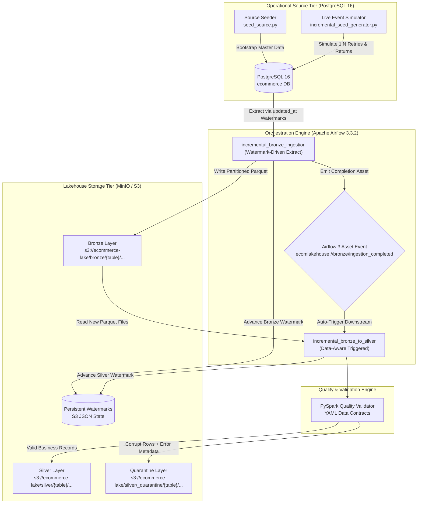
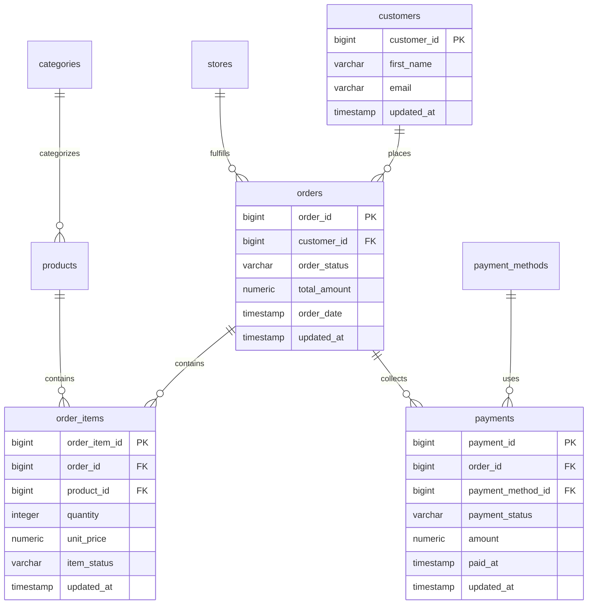

<div align="center">

# 🛍️ EcomLakehouse

<p align="center">
  <b>Production-Grade Event-Driven Medallion Data Lakehouse for E-Commerce</b>
</p>
<p align="center">
  Continuous incremental CDC pipelines, Airflow 3 Asset scheduling, PySpark data quality contracts, and automated quarantine storage.
</p>

<div align="center">

  
  
  
  
  
  

</div>

<br>

<p align="center">
  <a href="#-the-problem">The Problem</a> •
  <a href="#-the-solution">The Solution</a> •
  <a href="#-architecture">Architecture</a> •
  <a href="#-data-quality--quarantine-framework">Data Quality</a> •
  <a href="#-airflow-3-asset-orchestration">Airflow Orchestration</a> •
  <a href="#-storage-layout--engine">Storage Layout</a> •
  <a href="#-quick-start-guide">Quick Start</a> •
  <a href="#-service-ports--connectivity">Service Ports</a>
</p>

</div>

<br>

---

## &nbsp; The Problem

Traditional batch ETL workflows and scheduled cron ingestion fall short when scaling modern transactional workloads:

<table width="100%">
  <tr>
    <td width="33%" valign="top" align="center">
      <br>
      <h3 align="center">&nbsp; Polling Latency</h3>
      <p align="center">Rigid cron-based schedules waste compute polling idle databases and introduce 30–60 minute delays before downstream analytics reflect fresh transactions.</p>
      <br>
    </td>
    <td width="33%" valign="top" align="center">
      <br>
      <h3 align="center">&nbsp; Silent Data Poisoning</h3>
      <p align="center">A single corrupted record (negative price, future timestamp, or invalid status) either halts the entire pipeline or quietly pollutes production business dashboards.</p>
      <br>
    </td>
    <td width="33%" valign="top" align="center">
      <br>
      <h3 align="center">&nbsp; CDC Watermark Jitter</h3>
      <p align="center">Relying on ephemeral Airflow run states risks duplicate reads or skipped increments during container restarts, task retries, or clock skew.</p>
      <br>
    </td>
  </tr>
</table>

<br>

## &nbsp; The Solution

**EcomLakehouse** provides a decoupled, resilient, and event-driven Medallion Lakehouse built on modern data engineering standards:

* **Event-Driven Asset Scheduling**: Uses **Airflow 3 Data-Aware Assets** (`Asset("ecomlakehouse://bronze/ingestion_completed")`). The moment Bronze extraction finishes, Silver transforms ignite automatically with **zero polling delay**.
* **Declarative Quality Contracts & Quarantine**: Implements a declarative YAML contract engine powered by **PySpark**. Clean records advance to Silver; corrupt records are tagged with root-cause error arrays and safely diverted to an audited **Quarantine** area without breaking the pipeline.
* **Persistent Watermark Checkpoints**: Checkpoints are stored as immutable JSON state files directly in S3 (`bronze/_checkpoints/` and `silver/_checkpoints/`), guaranteeing deterministic, exactly-once incremental extraction cycles under **15 seconds**.
* **Realistic E-Commerce Event Simulator**: Built-in synthetic event engine generating realistic Indian e-commerce scenarios—UPI/COD workflows, 1:N payment retries, partial item returns, and catalog updates across 500k+ records.

<br>

---

## &nbsp; Architecture



### Medallion Tier Specifications

| Layer | Path / Location | Format | Description | Status |
| :--- | :--- | :--- | :--- | :--- |
| **Bronze** | `s3://ecommerce-lake/bronze/{table}/ingestion_date=YYYY-MM-DD/` | Apache Parquet | Raw, immutable append-only transactional data extracted via timestamp watermarks. | **Active** |
| **Quarantine** | `s3://ecommerce-lake/silver/_quarantine/{table}/ingestion_date=YYYY-MM-DD/` | Apache Parquet | Isolated anomaly records enriched with `validation_errors` metadata for offline remediation. | **Active** |
| **Silver** | `s3://ecommerce-lake/silver/{table}/ingestion_date=YYYY-MM-DD/` | Apache Parquet | Validated, schema-enforced, and deduplicated records prepared for analytics and BI. | **Active** |
| **Gold** | `s3://ecommerce-lake/gold/` | Dimensional Parquet | Star-schema dimensional models (Fact Orders, Dim Customers, Cohort Analytics). | _Roadmap_ |

<br>

---

## &nbsp; Data Quality & Quarantine Framework

Validation rules are centrally defined in declarative YAML ([src/ecomlakehouse/silver/quality_rules_v1.yml](src/ecomlakehouse/silver/quality_rules_v1.yml)) and evaluated at scale using high-throughput **Apache Spark** SQL expressions:

<table width="100%">
  <tr>
    <th>Rule Category</th>
    <th>Description</th>
    <th>Sample Assertion Expression</th>
  </tr>
  <tr>
    <td><b>Completeness</b></td>
    <td>Enforces non-null primary keys and required business columns.</td>
    <td><code>order_id IS NOT NULL AND customer_id IS NOT NULL</code></td>
  </tr>
  <tr>
    <td><b>Allowed Values / Enums</b></td>
    <td>Validates allowed state machine transitions and status values.</td>
    <td><code>order_status IN ('PLACED', 'CONFIRMED', 'SHIPPED', 'DELIVERED', 'CANCELLED', 'RETURNED')</code></td>
  </tr>
  <tr>
    <td><b>Numeric Bounds</b></td>
    <td>Guarantees positive quantities and non-negative pricing.</td>
    <td><code>quantity > 0 AND unit_price >= 0.0</code></td>
  </tr>
  <tr>
    <td><b>Temporal Guardrails</b></td>
    <td>Prevents future transaction timestamps and verifies sequence logic.</td>
    <td><code>order_date <= current_timestamp() + INTERVAL 1 DAY AND updated_at >= created_at</code></td>
  </tr>
  <tr>
    <td><b>Conditional Integrity</b></td>
    <td>Asserts relationship consistency across dependent columns.</td>
    <td><code>(payment_status != 'SUCCESS') OR (paid_at IS NOT NULL)</code></td>
  </tr>
  <tr>
    <td><b>Regex Formatting</b></td>
    <td>Validates format conformance for customer emails and contact details.</td>
    <td><code>email RLIKE '^[A-Za-z0-9._%+-]+@[A-Za-z0-9.-]+\\.[A-Za-z]{2,}$'</code></td>
  </tr>
</table>

### Non-Blocking Quarantine Isolation

When data contract violations occur:
1. PySpark applies rule assertions and aggregates failed checks into a structured string array: `validation_errors = ['quantity_gt_0', 'payment_status_valid']`.
2. Clean records (`size(validation_errors) == 0`) flow directly into `silver/{table}/`.
3. Failing records (`size(validation_errors) > 0`) are written to `silver/_quarantine/{table}/` along with their error context.
4. The pipeline does **not** fail; watermarks advance cleanly, preventing unblocked processing pipelines while ensuring full auditability.

<br>

---

## &nbsp; Airflow 3 Asset Orchestration

The pipeline is orchestrated with a modern, purely **incremental, data-aware event architecture**:

```text
┌─────────────────────────────────┐
│  incremental_bronze_ingestion   │
│  (Scheduled: 0/30 * * * *)      │
└───────────────┬─────────────────┘
                │ Emits: Asset("ecomlakehouse://bronze/ingestion_completed")
                ▼
┌─────────────────────────────────┐
│  incremental_bronze_to_silver   │
│  (Asset-Triggered: Instant)     │
└─────────────────────────────────┘
```

| DAG ID | Schedule / Trigger | Catchup | Description |
| :--- | :--- | :--- | :--- |
| **`incremental_bronze_ingestion`** | `0/30 * * * *` (Every 30m) | `False` | Extracts modified records using `updated_at` watermarks from PostgreSQL. Uses an end-of-pipeline barrier task to emit the completion Asset once all 7 tables commit. |
| **`incremental_bronze_to_silver`** | `[Asset]` (Automatic) | `False` | Triggered instantaneously upon Bronze completion. Validates raw Parquet files via Spark, writes clean rows to Silver, routes anomalies to Quarantine, and advances Silver watermarks. |
| **`incremental_seed_generator`** | `*/10 * * * *` (Every 10m) | `False` | Simulates high-velocity e-commerce user activity: UPI/COD transactions, partial order returns, payment retries, and customer profile updates. |

<br>

---

## &nbsp; Storage Layout & Engine

The Lakehouse structure is organized into clean, partitioned, and isolated object prefixes:

```text
ecommerce-lake/
├── bronze/
│   ├── _staging/{run_id}/
│   │   ├── orders.parquet
│   │   └── orders_transformed.parquet
│   ├── _checkpoints/
│   │   ├── categories.json
│   │   ├── customers.json
│   │   ├── order_items.json
│   │   ├── orders.json
│   │   └── payments.json
│   ├── categories/ingestion_date=2026-10-27/categories_20261027T120855Z.parquet
│   ├── customers/ingestion_date=2026-10-27/customers_20261027T120855Z.parquet
│   ├── order_items/ingestion_date=2026-10-27/order_items_20261027T120855Z.parquet
│   ├── orders/ingestion_date=2026-10-27/orders_20261027T120855Z.parquet
│   └── payments/ingestion_date=2026-10-27/payments_20261027T120855Z.parquet
├── silver/
│   ├── _checkpoints/
│   │   ├── categories.json
│   │   ├── customers.json
│   │   ├── order_items.json
│   │   ├── orders.json
│   │   └── payments.json
│   ├── _quarantine/
│   │   └── orders/ingestion_date=2026-10-27/orders_quarantine_20261027T121355Z.parquet
│   ├── categories/ingestion_date=2026-10-27/categories_20261027T121355Z.parquet
│   ├── customers/ingestion_date=2026-10-27/customers_20261027T121355Z.parquet
│   ├── order_items/ingestion_date=2026-10-27/order_items_20261027T121355Z.parquet
│   ├── orders/ingestion_date=2026-10-27/orders_20261027T121355Z.parquet
│   └── payments/ingestion_date=2026-10-27/payments_20261027T121355Z.parquet
```

<br>

---

## &nbsp; Source Relational Model

The source transactional database represents a full-featured e-commerce catalog and order management system:



<br>

---

## &nbsp; Technology Stack

* **Language**: Python 3.11+
* **Package Manager**: [`uv`](https://astral.sh/uv) (Extremely fast, Rust-backed package resolver)
* **Orchestration**: Apache Airflow 3.3.2 (LocalExecutor, Data-Aware Assets, API Server, DAG Processor)
* **Compute & Validation**: Apache Spark 3.5+ (PySpark with OpenJDK 17)
* **Source & Metadata Database**: PostgreSQL 16
* **Lakehouse Object Storage**: MinIO (AWS S3-compatible, high-throughput storage)
* **Core Libraries**: PyArrow, Pandas, SQLAlchemy 2.0, Psycopg 3, Boto3, Pendulum, PyYAML, Faker

<br>

---

## &nbsp; Repository Structure

```text
EcomLakehouse/
├── .env.example                     # Environment template configuration
├── pyproject.toml                   # UV Project dependencies & metadata
├── uv.lock                          # Deterministic lockfile
├── docker-compose.yml               # Unified multi-service Compose stack
├── README.md                        # Project documentation
│
├── airflow/
│   ├── Dockerfile                   # Multi-arch custom image (Airflow + Java 17 + PySpark)
│   ├── dags/                        # Active Airflow Pipelines
│   │   ├── incremental_bronze_ingestion.py   # Postgres -> Bronze incremental extract
│   │   ├── bronze_to_silver.py               # Bronze -> Silver PySpark quality & quarantine
│   │   └── incremental_seed_generator.py     # Live event simulator trigger
│   └── logs/                        # Airflow task logs
│
├── sql/
│   └── 01_source_schema.sql         # Source schema, indexes, and updated_at triggers
│
└── src/
    └── ecomlakehouse/
        ├── bronze/
        │   └── writer.py            # Partitioned Parquet writer for Bronze layer
        ├── constents/
        │   ├── checkpoints.py       # Centralized checkpoint configurations & constants
        │   └── tables.py            # Registered source table definitions
        ├── generator/
        │   ├── flipkart_catalog.py  # Realistic Indian e-commerce catalog & personas
        │   ├── seed_source.py       # Bootstrap seeder for initial master data
        │   └── incremental_seed_generator.py  # Live transaction simulator (retries, returns)
        ├── ingestion/
        │   ├── checkpoint.py        # S3 persistent watermark reader & writer (Bronze & Silver)
        │   └── postgres.py          # SQLAlchemy PostgreSQL query helper
        ├── quality/
        │   └── validator.py         # PySpark declarative rule validation engine
        ├── silver/
        │   ├── extractor.py         # Bronze incremental Parquet extractor
        │   ├── quality_rules_v1.yml # Declarative YAML data contracts
        │   └── writer.py            # Silver & Quarantine Parquet writers
        └── utils/
            ├── logging_utils.py     # Structured logging utilities
            ├── postgres.py          # Airflow PostgreSQL hook wrapper
            ├── spark.py             # Isolated PySpark session factory
            └── storage.py           # MinIO / AWS S3 client factory
```

<br>

---

## &nbsp; Quick Start Guide

### Step 1: Clone & Configure Environment

```bash
git clone https://github.com/mukeshkumar-krishnamoorthi/EcomLakehouse.git
cd EcomLakehouse

# Sync dependencies with uv
uv sync

# Configure environment variables
cp .env.example .env
```

> **Note:** Generate a secure Fernet key for Airflow:
> ```bash
> python -c "from cryptography.fernet import Fernet; print(Fernet.generate_key().decode())"
> ```
> Add the generated string to `AIRFLOW_FERNET_KEY` in `.env`.

### Step 2: Launch the Docker Compose Stack

A unified Compose file starts PostgreSQL, MinIO, and Airflow 3 services:

```bash
docker compose up -d --build
```

- PostgreSQL automatically provisions tables, foreign keys, and indexes via `sql/01_source_schema.sql`.
- `airflow-init` executes database migrations, creates the default admin user, configures the `ecom_postgres` connection, and provisions the `ecommerce-lake` storage bucket.

### Step 3: Seed Initial Historical Data

```bash
uv run python src/ecomlakehouse/generator/seed_source.py
```

### Step 4: Run Airflow Pipelines

1. Open the Airflow UI at [`http://localhost:8080`](http://localhost:8080) (using your configured credentials).
2. Trigger **`incremental_bronze_ingestion`**.
3. Once completed, it automatically emits the Asset event, instantaneously triggering **`incremental_bronze_to_silver`**!
4. Inspect the MinIO Web Console at [`http://localhost:9001`](http://localhost:9001) to view Parquet datasets landed in `bronze/`, `silver/`, and `silver/_quarantine/`.

<br>

---

## &nbsp; Service Ports & Connectivity

| Service | Container Name | Host Port | Internal Port | Purpose |
| :--- | :--- | :--- | :--- | :--- |
| **PostgreSQL (OLTP)** | `ecom-postgres` | `5441` | `5432` | Source transactional database |
| **MinIO S3 API** | `ecom-minio` | `9000` | `9000` | S3-compatible Object Storage |
| **MinIO Web Console** | `ecom-minio` | `9001` | `9001` | Web storage browser interface |
| **Airflow Web UI** | `ecom-airflow-apiserver` | `8080` | `8080` | Airflow 3 Web Console & API |
| **Airflow PostgreSQL**| `ecom-airflow-postgres` | `5442` | `5432` | Airflow internal metadata database |
| **Airflow Scheduler** | `ecom-airflow-scheduler` | — | — | DAG orchestration engine |
| **Airflow DAG Processor** | `ecom-airflow-dag-processor`| — | — | DAG discovery & parser |

<br>

---

## 👤 Author & License

Developed by **Mukeshkumar Krishnamoorthi**  
Distributed under the **MIT License**.
